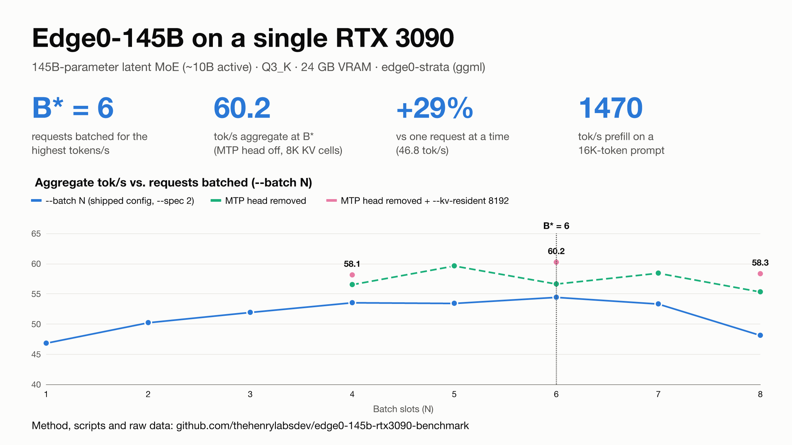
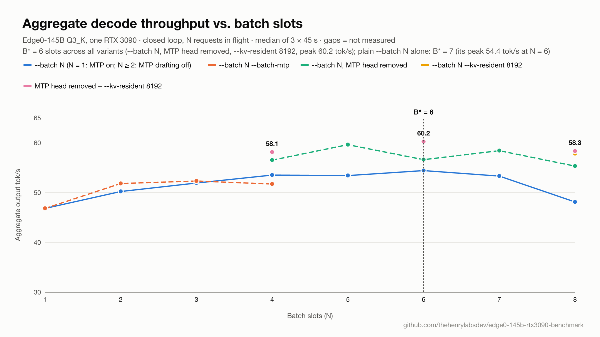

# Edge0-145B on a single RTX 3090

**How many requests should one RTX 3090 batch to get the most tokens per second out of a 145B-parameter
model?** This repository answers that with a reproducible sweep: every script, engine config, log and raw
number behind the answer is here.

[](https://github.com/thehenrylabsdev/edge0-145b-rtx3090-benchmark/actions/workflows/lint.yml)




## Results

**B\* = 6 requests batched → 60.2 tok/s aggregate**, with the MTP head removed and `--kv-resident 8192`.
That is +29 % over one request at a time (46.8 tok/s).

| Config | Best N | Aggregate tok/s | Per-request tok/s | TTFT |
|---|---|---|---|---|
| One request at a time (`--spec 2`, MTP on) | 1 | 46.8 | 58.7 | 1.1 s |
| Plain `--batch N` (shipped config, `--spec 2`) | 6 | 54.4 | 9.3 | 2.2 s |
| `--batch N`, MTP head removed | 5 | 59.6 | 12.8 | 2.1 s |
| **`--batch N`, MTP head removed, `--kv-resident 8192`** | **6** | **60.2** | 10.8 | 2.1 s |

- Every batch slot takes 0.73 GiB of VRAM from the expert cache, so past N = 6 more experts stream over
  PCIe and throughput falls (48.1 tok/s at N = 8 with the shipped config). Freeing VRAM elsewhere lifts
  the curve.
- Against the vendor's self-reported RTX 4090 numbers, the 3090 reaches 77 % of chat decode and 46 % of
  16K-token prefill.
- Whole study: 37 configurations, 3 × 45 s windows each, about 3 GPU-hours, about $1.60.



Full write-up: **[REPORT.md](REPORT.md)**.

## What was tested

| | |
|---|---|
| Model | [Edge0/Edge0-145B-q3k](https://huggingface.co/Edge0/Edge0-145B-q3k): 145B total, about 10B active per token, latent sparse MoE built from Qwen3.8-Flash-Next, Q3_K |
| Engine | edge0-strata (Edge0 commit `da9cc526`), built on ggml from llama.cpp `3cf03257`, sm_86 |
| GPU | 1× RTX 3090 24 GB, PCIe gen4 x16 |
| Host | EPYC 7H12 (32 vCPU, AVX-2), 116 GiB RAM, NVMe; RunPod Secure Cloud at $0.50/hr |
| Sweeps | prefill chunk, MTP speculative window, decode batch slots (`--batch N`, `--batch-mtp`, MTP head removed), long prompts, resident KV cells |
| Method | closed-loop streaming load generator, fresh engine per config, 3 × 45 s measured windows per config |

Stock llama.cpp cannot load this model: the pack keeps its experts outside the GGUF in a latent layout that
upstream's `qwen4exp` loader does not support. It runs on Edge0's own ggml-based engine, which reuses
llama.cpp's CUDA kernels. See [docs/model-analysis.md](docs/model-analysis.md).

## Repository layout

```text
REPORT.md              the full report: setup, method, results, recommendation, limits
docs/
  methodology.md       what every number means, B* rule, controls, known biases
  model-analysis.md    the model, the pack files, why stock llama.cpp cannot load it
  engine-and-build.md  build steps for sm_86, engine behaviour found during the study
  reproduce.md         run it yourself, on RunPod or any Linux box with a 3090
  lab-notebook.md      what happened, in order, including the dead ends
scripts/               pod-side harness (stdlib Python + bash): setup, download, load generator, sweeps
tools/                 laptop-side RunPod helpers (REST exec, push, pull); key read from the environment
charts/                results.csv -> ECharts specs -> SVG/PNG (no browser)
results/               results.csv, summary.json, per-config result.json, configs, engine logs, host facts
assets/                rendered charts and social cards
social/                ready-to-post text for X and LinkedIn
```

## Reproduce

```bash
bash scripts/setup.sh && bash scripts/download.sh && bash scripts/host_facts.sh
python3 scripts/make_specs.py /results/speclists && bash scripts/run_sweep.sh /results/speclists/p2-baseline.jsonl
python3 scripts/collect.py /results
python3 charts/build_charts.py && (cd charts && npm install && npm run render)
```

Step by step, with every phase: [docs/reproduce.md](docs/reproduce.md).

## Contributing

Ran it on different hardware? Please share it. The **New result** issue template asks for exactly what is
needed to compare runs. See [CONTRIBUTING.md](CONTRIBUTING.md).

## License and citation

- Code (`scripts/`, `tools/`, `charts/`): [MIT](LICENSE).
- Results, docs and images: [CC BY 4.0](LICENSE-DATA.md).
- The Edge0 model and engine are not included here and keep their own licenses.

To cite this work, see [CITATION.cff](CITATION.cff).

Edge0 model card numbers for other GPUs are self-reported by the vendor. This project is independent and
not affiliated with Edge0.
