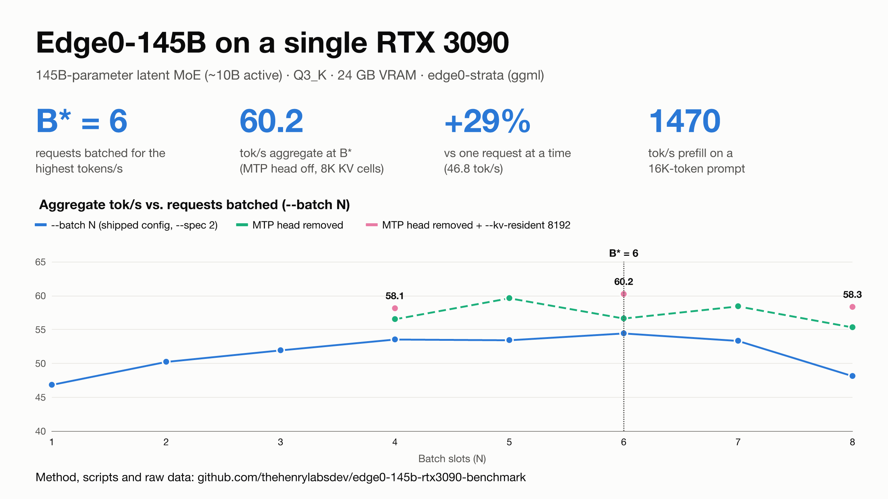
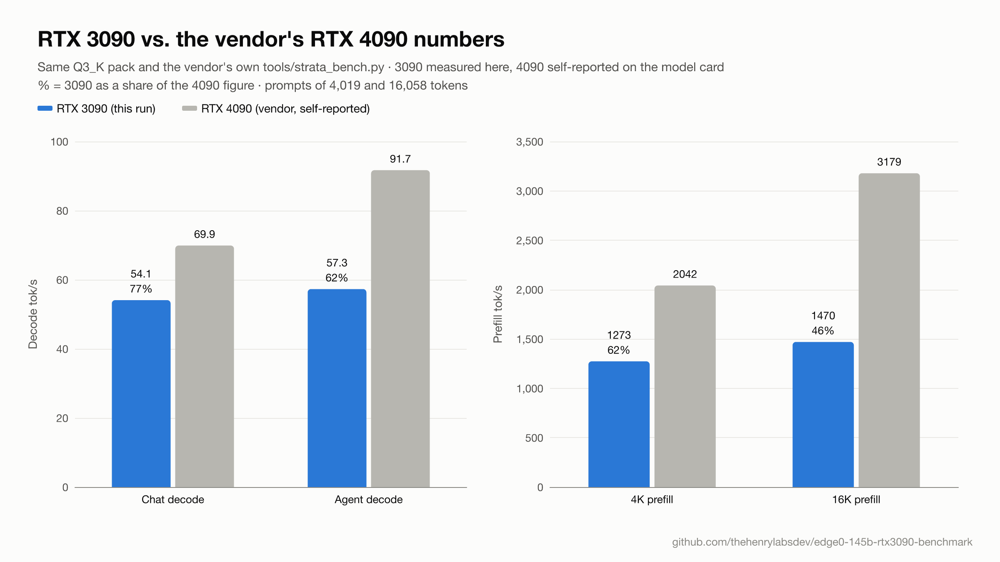
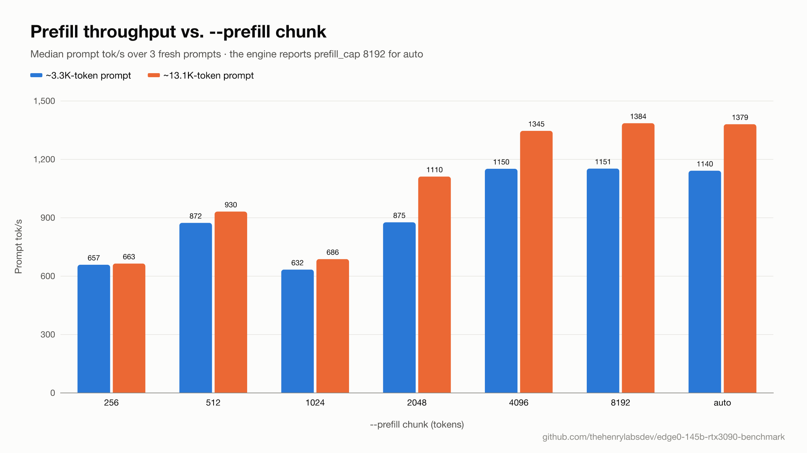
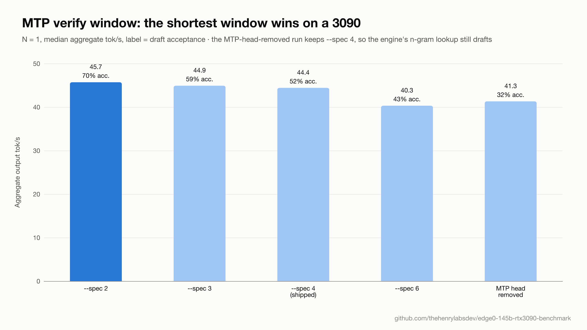
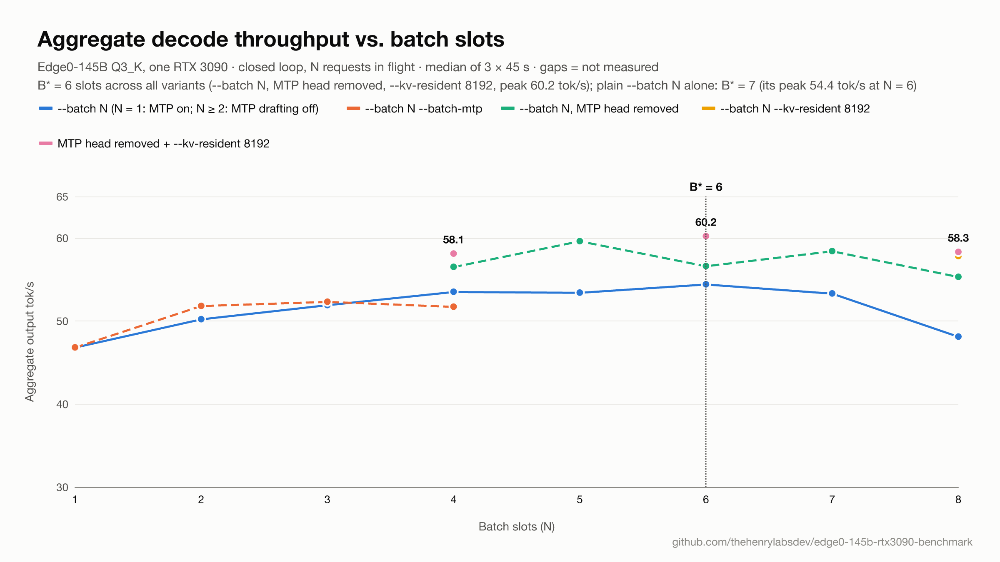
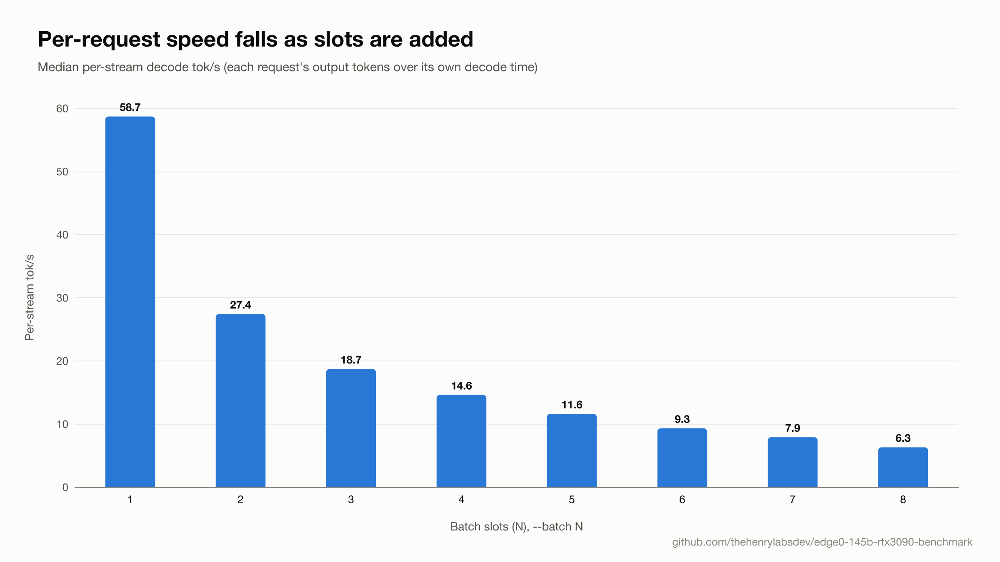

# Edge0-145B on a single RTX 3090: how many requests to batch for the most tokens per second

**Date:** 2026-11-14. **Model:** [Edge0/Edge0-145B-q3k](https://huggingface.co/Edge0/Edge0-145B-q3k).
**Engine:** edge0-strata at Edge0 commit `da9cc526` (ggml at llama.cpp `3cf03257`). **Hardware:** one RTX
3090 24 GB on a RunPod Secure Cloud host.

**Repository with every script, config, log and raw number:**
<https://github.com/thehenrylabsdev/edge0-145b-rtx3090-benchmark>



## TL;DR

- **B\* = 6.** On one RTX 3090, Edge0-145B (Q3_K) gives the most tokens per second with **6 requests
  batched**: **60.2 tok/s aggregate** (reps 59.7 / 60.2 / 60.4), with the MTP head removed and
  `--kv-resident 8192`.
- **+29 % over one request at a time** (46.8 tok/s at N = 1 with `--spec 2`), and +37 % over the shipped
  config at N = 1 (43.8 tok/s).
- **With the shipped config, batching gains less.** Plain `--batch N` peaks at 54.4 tok/s at N = 6, and
  falls to 48.1 tok/s at N = 8.
- **Why: every batch slot takes VRAM from the expert cache.** `--batch N` reserves 0.73 GiB per slot. At
  N = 8 the cache holds 3,507 experts instead of 7,360, so more experts stream over PCIe. Freeing VRAM
  elsewhere (the MTP head, which batch mode does not use, and resident KV cells) lifts the whole curve.
- **Each user pays for it.** At B\* every request decodes at 10.8 tok/s with a 2.1 s time to first token.
  One request alone decodes at 58.7 tok/s.
- **Single user:** `--spec 2` is the best MTP window on this card, 3 % faster than the shipped `--spec 4`.
- **Against the vendor's RTX 4090 numbers:** 77 % of its chat decode and 46 % of its 16K-token prefill.
- **Cost:** about 3 hours on one RunPod RTX 3090 at $0.50/hr, about $1.60.

## 1. The model, and why this is not stock llama.cpp

Edge0-145B is a 145B-parameter **latent sparse mixture-of-experts** built from Qwen3.8-Flash-Next:

- 48 layers, with three Gated-DeltaNet layers to each full-attention layer.
- 512 experts per layer, 10 routed + 1 shared, running in a 1792-wide latent space.
- About **10B parameters active per token**.

Two design choices let it run on a 24 GB card:

1. **Experts in a cache.** Experts are fixed-size records (1.63 MB each in Q3_K). The engine keeps
   thousands in VRAM and streams the rest from RAM over PCIe.
2. **The PLE table stays on disk.** A 51.2B-parameter fp8 n-gram embedding table is read straight from the
   SSD on every token.

The Q3_K pack is 103 GB on disk. The vendor plans 23 GiB of VRAM plus 31 GiB of RAM for it.

Upstream llama.cpp knows the base architecture (`qwen4exp`) but not Edge0's latent experts: the pack has
no `ffn_*_exps` tensors, so stock llama.cpp cannot load it. The model runs on **edge0-strata**, Edge0's
ggml-based engine that reuses llama.cpp's CUDA MMQ kernels. Details:
[docs/model-analysis.md](docs/model-analysis.md), [docs/engine-and-build.md](docs/engine-and-build.md).

## 2. Setup

| | |
|---|---|
| GPU | RTX 3090 24 GB, PCIe gen4 x16, 350 W limit, driver 595.91.07 (CUDA 13.2) |
| CPU / RAM | AMD EPYC 7H12 (Zen 2, **AVX-2 only**), 32 vCPU, 116.4 GiB cgroup limit |
| Disk | NVMe, fio 9.1 GB/s sequential, 98K IOPS random 4 KiB |
| Image | `nvidia/cuda:13.0.3-devel-ubuntu24.04`, nvcc 13.0, `CMAKE_CUDA_ARCHITECTURES=86` |
| Cloud | RunPod Secure Cloud, EU-CZ-1, $0.50/hr |
| Engine config | the pack's shipped `model.json`, changed one flag at a time |

## 3. Method in one paragraph

**Measurement.** A stdlib-only Python client drives the engine's OpenAI-compatible streaming endpoint in a
**closed loop**: N requests always in flight, each with a unique ~490-token prompt and a 256-token output
at temperature 0, with thinking off. Each configuration gets a fresh engine process, a 15 s warmup, then
**three measured 45 s windows**.

**Throughput counting.** Only tokens produced inside the window count, with requests that straddle an edge
pro-rated. The engine's own `/metrics` counters are recorded before and after every window as a
cross-check.

**B\***, the answer to "largest batch with the highest TPS", is **the largest N whose median aggregate
tok/s is within 2 % of the peak**. Three repetitions cannot separate configurations closer than about
2 %.

Full definitions and limitations: [docs/methodology.md](docs/methodology.md).

## 4. Results

### 4.1 Baseline: the 3090 against the vendor's 4090 numbers

The vendor's own `tools/strata_bench.py`, run on the same Q3_K pack with the shipped config:



| Test | RTX 3090 (this run) | RTX 4090 (model card, self-reported) | 3090 / 4090 |
|---|---|---|---|
| Chat decode | 54.1 tok/s | 69.9 | 77 % |
| Agent decode (5-turn coding session) | 57.3 tok/s | 91.7 | 62 % |
| Prefill, 4,019-token prompt | 1273 tok/s | 2042 | 62 % |
| Prefill, 16,058-token prompt | 1470 tok/s | 3179 | 46 % |

Decode stays closest to the 4090. Decode depends mostly on memory bandwidth (936 vs 1008 GB/s), PCIe
expert streaming and SSD reads. Prefill is compute-bound, and the 3090 falls further behind as the prompt
grows.

The vendor's benchmark config (`model-bench.json`: experts not held in RAM, no resident KV) was far slower
on this host: 36.4 vs 43.8 tok/s decode and 394 vs 1180 tok/s prefill. **Use the shipped `model.json`.**

### 4.2 Prefill chunk (`--prefill`)



- Larger chunks are faster up to the engine's cap. **`auto` (cap 8192) and `8192` are tied** at about
  1150 tok/s for ~3.3K-token prompts and about 1380 tok/s for ~13.1K-token prompts.
- **Prefill B\* = 8192**, which is what `auto` already picks.
- `--prefill 1024` was repeatably slower than 512 and 2048. The cause was not found.

### 4.3 MTP speculative window (`--spec`)



- **The shortest valid window wins on a 3090.** `--spec 2` gives 45.7 tok/s at 70 % draft acceptance,
  3 % faster than the shipped `--spec 4` (44.4 tok/s) and 13 % faster than `--spec 6`.
- **Longer windows don't pay off here.** They draft more tokens that get rejected, and verifying them costs
  more on this card than they save.
- **Removing the MTP head costs about 10 %** (41.3 tok/s).
- **`--spec` cannot go below 2.** This pack refuses to start below 2, so "speculation off" is not an option.

### 4.4 Decode batch slots (`--batch N`): the main question



Median of three 45 s windows, aggregate output tok/s with N requests always in flight. Expert slots are
the experts the engine cached in VRAM, read from `/metrics`.

**Plain `--batch N`** (shipped config with `--spec 2`):

| N | Aggregate tok/s (median) | Range of 3 reps | Per-request tok/s | TTFT | Experts in VRAM |
|---|---|---|---|---|---|
| 1 | 46.8 | 46.4–46.9 | 58.7 | 1.1 s | 7,360 |
| 2 | 50.2 | 47.9–51.2 | 27.4 | 1.1 s | 6,397 |
| 3 | 51.9 | 51.7–53.3 | 18.7 | 1.1 s | 5,915 |
| 4 | 53.5 | 52.8–53.6 | 14.6 | 1.2 s | 5,434 |
| 5 | 53.4 | 50.0–53.5 | 11.6 | 2.2 s | 4,951 |
| **6** | **54.4** (peak) | 52.0–55.4 | 9.3 | 2.2 s | 4,470 |
| 7 | 53.3 | 50.7–54.6 | 7.9 | 2.3 s | 3,988 |
| 8 | 48.1 | 46.4–49.4 | 6.3 | 2.4 s | 3,507 |

By the 2 % rule, plain B\* is **7**: 53.3 tok/s is 0.01 tok/s inside the band. That is a tie, not a
gain. N = 6 is the peak, and N = 6 is the better pick for this config, since each request runs 18 % faster.

**Variants that free VRAM:**

| Config | N | Aggregate tok/s (median) | Range | Per-request tok/s | TTFT | Experts in VRAM |
|---|---|---|---|---|---|---|
| MTP head removed | 4 | 56.5 | 55.7–58.4 | 15.8 | 1.1 s | 6,153 |
| MTP head removed | 5 | 59.6 | 58.4–60.6 | 12.8 | 2.1 s | 5,670 |
| MTP head removed | 6 | 56.6 | 56.2–58.9 | 10.4 | 2.2 s | 5,189 |
| MTP head removed | 7 | 58.4 | 57.3–60.2 | 8.6 | 2.2 s | 4,707 |
| MTP head removed | 8 | 55.3 | 53.5–55.6 | 7.2 | 2.4 s | 4,226 |
| `--kv-resident 8192` | 4 | 57.9 | 57.4–59.1 | 15.9 | 1.1 s | 5,916 |
| `--kv-resident 8192` | 8 | 57.8 | 55.0–59.7 | 7.5 | 2.3 s | 4,375 |
| MTP head removed + `--kv-resident 8192` | 4 | 58.1 | 53.3–58.7 | 16.0 | 1.2 s | 6,635 |
| **MTP head removed + `--kv-resident 8192`** | **6** | **60.2** (peak) | 59.7–60.4 | 10.8 | 2.1 s | 5,864 |
| MTP head removed + `--kv-resident 8192` | 8 | 58.3 | 57.5–63.2 | 7.5 | 2.3 s | 5,094 |
| `--batch-mtp` | 2 | 51.8 | 50.7–52.5 | 28.6 | 1.0 s | 6,328 |
| `--batch-mtp` | 3 | 52.3 | 51.8–53.6 | 19.1 | 1.1 s | 5,811 |
| `--batch-mtp` | 4 | 51.7 | 50.9–51.8 | 14.0 | 1.2 s | 5,293 |
| Long prompts (~3.3K tokens) | 4 | 41.1 | 40.2–41.5 | 13.2 | 5.4 s | 5,434 |
| Long prompts (~3.3K tokens) | 8 | 40.5 | 40.2–41.4 | 5.7 | 5.7 s | 3,507 |

**Across all variants, B\* = 6** (MTP head removed + `--kv-resident 8192`, 60.2 tok/s). The band runs down
to 59.0 tok/s, and only MTP head removed at N = 5 (59.6) also falls inside it. The combined config was
measured at N = 4, 6 and 8 only, so N = 7 for it is untested and could tie.



What the sweep shows:

1. **Throughput tracks the expert cache.** At N = 4, more cached experts means more throughput (the
   middle two are within noise): 5,434 experts → 53.5 tok/s, 5,916 → 57.9, 6,153 → 56.5,
   6,635 → 58.1. At N = 8, `--kv-resident 8192` alone lifts throughput by 20 % (48.1 → 57.8 tok/s) by
   shrinking each slot session from 0.73 to 0.58 GiB.
2. **The MTP head is dead weight in batch mode.** Plain `--batch N` turns MTP drafting off (one draft
   offered in most runs), yet the head still takes VRAM. Removing it adds 719 cached experts at every N
   and 4–15 % throughput.
3. **`--batch-mtp` does not help.** It keeps drafting for up to 4 slots but drafted little in this run
   (97 of 122 and 99 of 124 drafts accepted at N = 3 and 4), and it was no faster than plain `--batch`.
4. **Long prompts cost 16–23 % of the throughput.** With ~3.3K-token prompts, prefill takes a
   bigger share of each slot's time: about 41 tok/s at N = 4 and N = 8, and TTFT rises to 5–6 s.
5. **The first window of a batched config often reads low** (2–6 % below reps 1 and 2), which fits the
   adaptive expert cache still settling after the 15 s warmup. The median of three already discounts it.
6. **Per-request speed falls roughly as 1/N.** Aggregate throughput grows only 29 % from N = 1 to N = 6,
   while each user gets 5.4× slower. The batch size that maximises tok/s is a capacity choice, not a
   latency one.

## 5. Recommended configuration for an RTX 3090

**For the most total tokens per second (many users):** start from the pack's `model.json` and change
three things.

```diff
   "args": [
     ...
     "--spec", "4",
     "--spec-min-p", "0.5",
-    "--mtp", "./mtp",
     "--max-context", "131072",
     "--kv", "int8",
-    "--kv-resident", "32768",
+    "--kv-resident", "8192",
     ...
   ],
+  "parallel": 6
```

- `"parallel": 6` makes `server.py` start the engine with `--batch 6`.
- Removing `--mtp` drops the MTP head, which batch mode does not use. Keep `--spec`: the pack will not
  load without it.
- `--kv-resident 8192` keeps fewer KV cells in VRAM, which suits short and medium contexts. Long-context
  users may need more.

Expected: about 60 tok/s aggregate, about 11 tok/s and a 2 s first token per request. The exact file
measured is `results/runs/nomtp-kvres8k-6/cfg.json`.

**For one user at a time (fastest single answer):** keep the shipped `model.json`, with MTP on and no
`parallel`, and change `--spec 4` to `--spec 2`. That gave 45.7–46.8 tok/s end to end and about 58 tok/s
once the answer is streaming.

**Do not use `model-bench.json` on a host like this one.** It was 17 % slower at decode and about 3× slower
at prefill.

**Prefill:** keep `--prefill auto`. It picks 8192 here, the fastest chunk.

## 6. Engine behaviour worth knowing

These came from failed runs and engine logs, not from the docs:

1. **Native packs need `--spec` ≥ 2 and a `--prefill` chunk.** To turn MTP off, remove `--mtp`; the engine
   then falls back to n-gram drafting.
2. **`/metrics` reports the speculative window as T + 2.**
3. **Plain `--batch N` stops MTP drafting**, while the MTP head stays in VRAM. `--batch-mtp` keeps drafting,
   for up to 4 slots.
4. **`--batch N` allocates N slot sessions of 0.73 GiB each** (0.58 GiB with `--kv-resident 8192`), taken
   from the VRAM expert cache. One slot session is about 481 cached experts. A run without `--batch` has none.
5. **This CPU has no AVX-512**, so the engine's CPU expert kernels fall back to AVX-2. Many 3090 hosts are
   in the same position.
6. **A cold load reads 37 GiB of experts** (334 s at 3.6 GiB/s). A warm page cache brings it down to about
   30 s.

## 7. Limits of this study

- **One host.** CPU, PCIe and disk all shape this model's speed. Another 3090 box will land somewhere else.
- **Workload.** Closed-loop capacity with synthetic essay prompts. These numbers are not latency under
  random arrivals, and MTP acceptance will differ on code or chat.
- **Repetitions.** Three 45 s windows per config. Gaps under about 2 % are noise.
- **Vendor numbers.** The 4090 figures are the vendor's own, measured on a different machine.
- **Quality.** No quality evaluation. All configs run the same Q3_K weights, and speculative drafts are
  verified by the model.

## 8. Cost

| Item | Amount |
|---|---|
| RunPod Secure Cloud RTX 3090 pod, 125 GB RAM, 200 GB disk | $0.50/hr, 22:58 to about 02:00 UTC (about 3.0 h) |
| Billed by RunPod when this was written (posted through about 01:05 UTC) | $1.108 for the benchmark pod, plus $0.003 for a pod with too little RAM that was deleted at once |
| Expected final bill | about $1.60 |

The budget was 6 hours and $2.00. The run covered 37 measured configurations (plus a smoke test, and two
`--spec` settings that the pack refused to load), each with a fresh engine process and three
repetitions.

## Reproduce

See [docs/reproduce.md](docs/reproduce.md). The process, including the dead ends, is in
[docs/lab-notebook.md](docs/lab-notebook.md).
